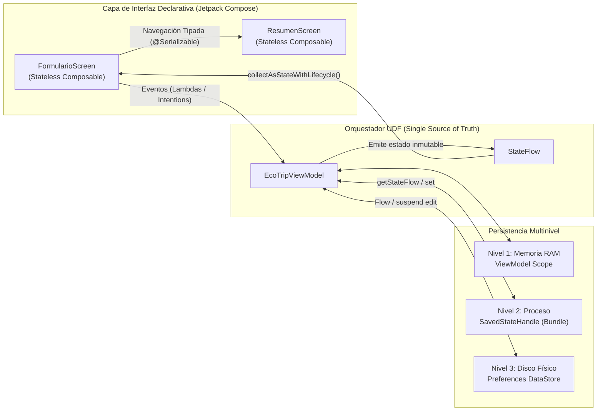

# EcoTrip 2026: Sistema Resiliente de Planificación de Rutas e Identidad Visual Adaptativa

> **Documento Oficial de Ingeniería y Guía de Entregables — Evaluación Práctica RDA-2**  
> **Asignatura:** Programación Móvil  
> **Institución:** Pontificia Universidad Católica del Ecuador (PUCE) — Escuela de Ingeniería en Sistemas de Información  
> **Estándar de Plataforma:** Android 16 (`compileSdk = 36` / `targetSdk = 36`) | Java 21 (JBR 21) | Kotlin 2.0 + Jetpack Compose  

---

## 1. Contexto y Estándar Técnico del Proyecto

### 1.1. Propósito de Ingeniería: Mitigación de la Volatilidad del Estado Móvil
En el ecosistema Android moderno, las aplicaciones están expuestas permanentemente a eventos destructivos del ciclo de vida: recreación de actividades por cambios de configuración (rotación de pantalla, cambio de idioma o modo oscuro), muerte súbita del proceso en segundo plano (*Process Death*) ejecutada por el *Low Memory Killer* del sistema operativo cuando escasea la memoria RAM, y cierres totales del proceso por parte del usuario.

**EcoTrip 2026** es un sistema nativo de planificación de rutas de turismo ecológico diseñado específicamente para **erradicar la volatilidad del estado**, articulando una arquitectura reactiva de **Persistencia Multinivel en Tres Capas (Memoria, Proceso y Disco)** junto con **Navegación Fuertemente Tipada en Tiempo de Compilación** e **Identidad Visual Adaptativa (Material Design 3 / Material You)**.

### 1.2. Especificación del Blindaje Técnico del Entorno
El proyecto se encuentra blindado bajo los siguientes estándares de construcción para garantizar compilaciones deterministas y reproducibles entre todas las estaciones de trabajo del equipo:

* **Nivel de API Objetivo y Compilación:** Bloqueado estrictamente en **Android 16 (`compileSdk = 36` y `targetSdk = 36`)** con retrocompatibilidad desde `minSdk = 26` (Android 8.0 Oreo), declarado en [app/build.gradle.kts](file:///c:/Users/User/AndroidStudioProjects/ProfileValidator/app/build.gradle.kts#L11-L19).
* **Máquina Virtual y Bytecode:** Compilación forzada sobre **Java 21 / JetBrains Runtime (JBR 21)** mediante `sourceCompatibility = JavaVersion.VERSION_21`, `targetCompatibility = JavaVersion.VERSION_21` y `jvmTarget = "21"` en [app/build.gradle.kts](file:///c:/Users/User/AndroidStudioProjects/ProfileValidator/app/build.gradle.kts#L21-L29).
* **Gobernanza de Dependencias (Version Catalog):** Todas las librerías y plugins (Jetpack Compose BOM, Navigation Compose `2.8.5`, Preferences DataStore `1.1.1`, Kotlinx Serialization JSON `1.6.3` y Lifecycle ViewModel Compose `2.8.5`) están declarados y congelados en una única fuente de verdad dentro del catálogo de versiones [gradle/libs.versions.toml](file:///c:/Users/User/AndroidStudioProjects/ProfileValidator/gradle/libs.versions.toml).
* **Arquitectura de Actividad Única 100% Declarativa:** El sistema opera sobre una sola actividad ([MainActivity.kt](file:///c:/Users/User/AndroidStudioProjects/ProfileValidator/app/src/main/java/com/example/laboratorio1/MainActivity.kt)), prescindiendo por completo de archivos XML de diseño (`res/layout`) y de llamadas imperativas obsoletas como `findViewById`.

---

## 2. Arquitectura UDF y Resiliencia Multinivel de Datos

### 2.1. Patrón de Flujo Unidireccional de Datos (UDF) y State Hoisting
La capa de presentación aplica de forma estricta el patrón **Unidirectional Data Flow (UDF)** combinado con **Elevación de Estado (*State Hoisting*)**:

1. **El Estado Desciende (ViewModel $\rightarrow$ UI):** [`EcoTripViewModel`](file:///c:/Users/User/AndroidStudioProjects/ProfileValidator/app/src/main/java/com/example/laboratorio1/viewmodel/EcoTripViewModel.kt) consolida las fuentes de datos y expone un único flujo reactivo inmutable `uiState: StateFlow<EcoTripUiState>`, el cual es observado de manera segura respecto al ciclo de vida por la interfaz mediante `collectAsStateWithLifecycle()`.
2. **Los Eventos Ascienden (UI $\rightarrow$ ViewModel):** Las vistas ([`FormularioScreen`](file:///c:/Users/User/AndroidStudioProjects/ProfileValidator/app/src/main/java/com/example/laboratorio1/ui/screens/FormularioScreen.kt) y [`ResumenScreen`](file:///c:/Users/User/AndroidStudioProjects/ProfileValidator/app/src/main/java/com/example/laboratorio1/ui/screens/ResumenScreen.kt)) son funciones `@Composable` sin estado interno de negocio (*stateless*); cualquier interacción del usuario se propaga hacia arriba mediante funciones lambda (`onNombreChange`, `onTransporteSelect`, `onSoloBajaHuellaChange`, `onDestinoChange`, `onDiasDuracionChange`, `onViajeGrupalChange`).



### 2.2. Modelo de Dominio Inmutable (`PreferenciaViaje`)
Definido en [PreferenciaViaje.kt](file:///c:/Users/User/AndroidStudioProjects/ProfileValidator/app/src/main/java/com/example/laboratorio1/data/model/PreferenciaViaje.kt#L14-L19), encapsula las preferencias globales del usuario empleando **propiedades estrictamente inmutables (`val`)**:

* `val nombreViajero: String`: Identificador nominal del viajero titular.
* `val tipoTransporte: String`: Modalidad de movilidad ecológica seleccionada (`"Tren"`, `"Bicicleta"` o `"Vehículo Eléctrico"`).
* `val soloBajaHuella: Boolean`: Interruptor booleano que restringe la planificación a rutas de mínima huella de carbono.

El uso exclusivo de `val` garantiza seguridad ante concurrencia (*Thread-Safety*), evita mutaciones colaterales y permite que el motor de recomposición inteligente de Jetpack Compose detecte cambios estructurales de manera eficiente.

### 2.3. Estrategia de Persistencia en Tres Niveles

| Nivel | Componente Técnico | Datos Resguardados | Amenaza Mitigada | Mecanismo de Implementación |
| :--- | :--- | :--- | :--- | :--- |
| **Nivel 1: Memoria** | [`EcoTripViewModel`](file:///c:/Users/User/AndroidStudioProjects/ProfileValidator/app/src/main/java/com/example/laboratorio1/viewmodel/EcoTripViewModel.kt) | `EcoTripUiState`, validaciones en curso y estado de `Snackbar` | Recomposiciones continuas y **rotación de pantalla** (cambio de configuración). | `StateFlow` con operador `combine(...)` y `stateIn(viewModelScope, SharingStarted.WhileSubscribed(5000))`. |
| **Nivel 2: Proceso** | `SavedStateHandle` | `destino`, `diasDuracion` (input temporal) y `esViajeGrupal` | **Muerte del Proceso (*Process Death*)** ejecutada por el SO en segundo plano (`Don't keep activities`). | Enlace reactivo `savedStateHandle.getStateFlow(KEY, DEFAULT)` y escritura en el `Bundle` del sistema. |
| **Nivel 3: Disco** | [`DataStoreManager`](file:///c:/Users/User/AndroidStudioProjects/ProfileValidator/app/src/main/java/com/example/laboratorio1/data/local/DataStoreManager.kt) (`Preferences DataStore`) | Preferencias globales: `nombreViajero`, `tipoTransporte` y `soloBajaHuella` | **Cierre total / forzado de la app (*Force Stop*)** y apagado o reinicio del dispositivo. | Lectura reactiva con `Flow<PreferenciaViaje>` (manejo de `IOException`) y escritura asíncrona transaccional con `suspend fun` y `dataStore.edit`. |

---

## 3. Navegación Fuertemente Tipada (Type-Safety) y Material You

### 3.1. Grafo de Navegación Tipado (`@Serializable`) e Higiene del Back Stack
El proyecto erradica el uso de rutas basadas en cadenas de texto (`"resumen/{destino}/{dias}"`) e implementa **Navigation Compose 2.8.5 con Kotlinx Serialization**:

1. **Definición Fuera del Grafo ([EcoTripRoutes.kt](file:///c:/Users/User/AndroidStudioProjects/ProfileValidator/app/src/main/java/com/example/laboratorio1/navigation/EcoTripRoutes.kt)):**
   * `@Serializable data object FormularioRoute`: Punto de entrada sin argumentos (`startDestination`).
   * `@Serializable data class ResumenRoute(...)`: Contrato de destino que exige en tiempo de compilación `val destino: String`, `val diasDuracion: Int`, `val esViajeGrupal: Boolean`, junto con los datos validados del viajero.
2. **Único `NavHost` y Extracción `.toRoute<ResumenRoute>()` ([EcoTripNavHost.kt](file:///c:/Users/User/AndroidStudioProjects/ProfileValidator/app/src/main/java/com/example/laboratorio1/ui/navigation/EcoTripNavHost.kt#L35-L75)):**
   * En el destino `composable<ResumenRoute>`, los argumentos se extraen de forma tipada mediante `val route: ResumenRoute = backStackEntry.toRoute()`.
3. **Limpieza de la Pila de Navegación (*Back Stack*):**
   * Al pulsar el botón de salida/reinicio en el `TopAppBar` de la pantalla de resumen, se ejecuta:
     ```kotlin
     navController.navigate(FormularioRoute) {
         popUpTo<FormularioRoute> { inclusive = false }
         launchSingleTop = true
     }
     ```
   * Esta configuración desapila la pantalla de resumen de la memoria y reutiliza la instancia superior de `FormularioRoute`, evitando la duplicación de pantallas en el historial.

### 3.2. Andamiaje Material Design 3 y Color Dinámico (Material You)
* **Estructura Base con `Scaffold`:** Tanto [`FormularioScreen`](file:///c:/Users/User/AndroidStudioProjects/ProfileValidator/app/src/main/java/com/example/laboratorio1/ui/screens/FormularioScreen.kt#L103-L166) como [`ResumenScreen`](file:///c:/Users/User/AndroidStudioProjects/ProfileValidator/app/src/main/java/com/example/laboratorio1/ui/screens/ResumenScreen.kt#L107-L150) estructuran su disposición visual mediante el componente `Scaffold` de Material 3, integrando `TopAppBar` y botones de acción flotantes (`FloatingActionButton` / `ExtendedFloatingActionButton`) respetando el `innerPadding` de las barras del sistema (*Edge-to-Edge*).
* **Motor de Color Dinámico (`Material You`):** En [`EcoTripTheme`](file:///c:/Users/User/AndroidStudioProjects/ProfileValidator/app/src/main/java/com/example/laboratorio1/ui/theme/Theme.kt#L61-L80), cuando el dispositivo ejecuta Android 12+ (incluyendo el entorno objetivo API 36), se invocan `dynamicDarkColorScheme(context)` y `dynamicLightColorScheme(context)` para extraer en tiempo real la paleta cromática del fondo de pantalla (*Wallpaper*) del usuario.
* **Roles Cromáticos Semánticos:** Las pantallas consumen exclusivamente roles de `MaterialTheme.colorScheme` (`primary`, `onPrimary`, `primaryContainer`, `onPrimaryContainer`, `secondaryContainer`, `tertiary`, `surface`, `onSurfaceVariant`, `error`), sin utilizar colores hexadecimales fijos (`Color(0xFF...)`) en los componentes visuales.

### 3.3. Sanitización contra Nulos y Plantillas Idiomáticas de Kotlin
* **Conversión Numérica Segura:** En [`EcoTripViewModel`](file:///c:/Users/User/AndroidStudioProjects/ProfileValidator/app/src/main/java/com/example/laboratorio1/viewmodel/EcoTripViewModel.kt#L74-L95), la entrada de días de duración se procesa con `diasInput.toIntOrNull()` combinada con el **operador Elvis (`?: 1`)**, garantizando que entradas vacías o alfanuméricas jamás disparen un `NumberFormatException`.
* **Operador de Llamada Segura (`?.`):** Empleado en la gestión reactiva de mensajes e indicadores de error (`uiState.mensajeSnackbar?.let { ... }` y `uiState.errorDestino?.let { ... }`).
* **Plantillas de Cadena (`$`):** En [`ResumenScreen`](file:///c:/Users/User/AndroidStudioProjects/ProfileValidator/app/src/main/java/com/example/laboratorio1/ui/screens/ResumenScreen.kt#L200-L285), los parámetros tipados se interpolan directamente mediante expresiones idiomáticas de Kotlin (`"${route.diasDuracion} días"`, `"Viajero titular: ${route.nombreViajero}"`, `"Movilidad mediante ${route.tipoTransporte}"`).

---

## 4. Instrucciones de Capturas y Entregables para el Informe PDF (¡Obligatorio!)

El equipo de documentación debe incluir obligatoriamente las siguientes **3 evidencias gráficas** ejecutadas sobre un **Emulador Android API 36**, además del enlace a GitHub y el anexo de código:

1. **Captura 1 (Formulario en vertical):**
   * Ejecutar la aplicación en el emulador **API 36** en orientación vertical (*Portrait*).
   * Ingresar datos válidos completos en el Formulario de Viaje (Nombre del viajero, transporte ecológico, switch de baja huella, destino y duración en días) y tomar la captura de pantalla.
2. **Captura 2 (Prueba de Resiliencia ante Rotación / Process Death):**
   * Activar la opción **`Don't keep activities`** (*Destruir actividades al salir*) en las Opciones de Desarrollador del emulador o rotar el emulador a **modo horizontal (`Ctrl + F12`)**.
   * Capturar la pantalla demostrando que tanto los datos de `DataStore` como los de `SavedStateHandle` permanecen **100% intactos sin perder ni una sola letra**.
3. **Captura 3 (Resumen y Adaptabilidad Material You):**
   * Ir a los Ajustes del emulador y **cambiar el fondo de pantalla (*Wallpaper*)** por uno de tonalidad contrastante (por ejemplo, de verde a azul o cálido).
   * Navegar a la **Pantalla de Resumen de Ruta** y tomar captura evidenciando que el `TopAppBar`, las tarjetas (`primaryContainer`, `secondaryContainer`) y las superficies adoptaron automáticamente la nueva paleta de colores dinámicos del sistema.
4. **Historial Colaborativo de GitHub (Mínimo 4 Commits):**
   * Verificar e incluir en la portada/desarrollo del PDF la URL pública del repositorio mostrando al menos los **4 commits descriptivos obligatorios** firmados por los integrantes del equipo:
     1. `feat: data models and routes`
     2. `feat: viewmodel and dataStore implementation`
     3. `feat: compose ui layout with material design 3`
     4. `feat: type-safe navigation and testing`
5. **Anexo de Código Fuente:**
   * Copiar todo el código fuente estructurado y limpio al final del documento PDF (`libs.versions.toml`, `build.gradle.kts`, `PreferenciaViaje.kt`, `EcoTripRoutes.kt`, `DataStoreManager.kt`, `EcoTripUiState.kt`, `EcoTripViewModel.kt`, `Theme.kt`, `EcoTripNavHost.kt`, `FormularioScreen.kt`, `ResumenScreen.kt` y `MainActivity.kt`).

---

## 5. Insumos Listos para el Informe Técnico en PDF (Normas APA 7)

> *Instrucción para los compañeros de documentación: Copien e integren directamente los siguientes bloques en las secciones correspondientes del Informe Técnico en PDF.*

---

### A. Explicación Conceptual Obligatoria: Navegación Tipada (Type-Safety) vs. Rutas Basadas en Texto (Strings)

#### Justificación Técnica de la Navegación Fuertemente Tipada (Type-Safety)

En el desarrollo tradicional con Jetpack Compose, la definición del grafo de navegación mediante cadenas de texto estáticas (*Legacy Strings*, como `"profile/{userId}"`) o el empaquetado manual en objetos `Bundle` representa una fuente crítica de fragilidad estructural y deuda técnica. Este enfoque obsoleto padece de dos vulnerabilidades severas: primero, los errores tipográficos silenciosos en las rutas no son detectados por el compilador; segundo, el paso de tipos de datos incompatibles en la cadena de navegación (por ejemplo, inyectar texto alfanumérico donde la vista destino espera un entero) provoca cierres forzados (*crashes* tardíos) directamente en tiempo de ejecución cuando el usuario interactúa con la aplicación.

La incorporación de contratos fuertemente tipados mediante la anotación `@Serializable` en la API 36 transforma radicalmente esta arquitectura al convertir cada ruta de destino en una clase u objeto de primera categoría dentro del sistema de tipos de Kotlin. Al invocar el desplazamiento hacia la pantalla de resumen e hidratar los argumentos mediante el método de deserialización automática `.toRoute()`, la verificación de integridad se traslada del tiempo de ejecución al tiempo de compilación. De esta manera, el compilador exige el cumplimiento estricto de los parámetros declarados (como `String`, `Int` o `Boolean`), garantizando refactorizaciones seguras, eliminando el código repetitivo (*boilerplate*) y erradicando los *crashes* por desajustes de argumentos durante la navegación.

---

### B. Descripción de la Arquitectura e Interacción Multinivel

* **Separación bajo Flujo Unidireccional de Datos (UDF):** La aplicación aísla la capa de interfaz declarativa (`FormularioScreen` y `ResumenScreen` orquestadas por un único `NavHost`) de la lógica de persistencia. El componente `EcoTripViewModel` opera como la única fuente de verdad (*Single Source of Truth*), haciendo que el estado descienda de forma reactiva hacia la interfaz mientras los eventos del usuario ascienden mediante invocaciones de funciones seguras.
* **Inmutabilidad del Modelo (`PreferenciaViaje`):** Los datos de configuración se encapsulan en una `data class` cuyas propiedades se declaran estrictamente como referencias de solo lectura (`val`), previniendo mutaciones accidentales y garantizando seguridad en entornos concurrentes (*Thread-Safety*).
* **Estrategia de Persistencia en Tres Niveles:**
  1. **Memoria (`ViewModel`):** Mantiene los estados vivos durante las sucesivas recomposiciones de la interfaz y sobrevive a cambios de configuración como la rotación del dispositivo.
  2. **Proceso (`SavedStateHandle`):** Resguarda los datos temporales del formulario (destino y días de duración) serializándolos en el estado de instancia del sistema, permitiendo que la interfaz se autorrepare si el sistema operativo ejecuta una muerte del proceso (*Process Death*) en segundo plano por falta de memoria RAM.
  3. **Disco (`Preferences DataStore`):** Almacena de manera asíncrona y definitiva en la memoria física del dispositivo las preferencias globales del viajero (nombre e interruptor de baja huella de carbono), sobreviviendo al cierre total de la aplicación.

---

### C. Formato de Títulos para las 3 Capturas del Emulador (API 36) en Normas APA 7

> **Nota de redacción APA 7:** Recuerden iniciar el párrafo explicativo previo a cada imagen diciendo **"Ver figura X."** y colocar el encabezado sobre la imagen con el número en **negrita** y el título en *cursiva* debajo:

* **Figura 1**  
  *Formulario de planificación EcoTrip 2026 en modo vertical con datos de ruta ingresados.*

* **Figura 2**  
  *Persistencia intacta de los datos del formulario tras la prueba de rotación de pantalla y recreación de la actividad (Process Death).*

* **Figura 3**  
  *Pantalla de resumen de ruta acoplada dinámicamente a la paleta cromática del sistema (Material You) tras modificar el fondo de pantalla en Android 16 (API 36).*

---

### D. Conclusiones y Recomendaciones de Ingeniería (Citadas en APA 7)

#### Conclusiones

1. **Supervivencia integral mediante persistencia multinivel:** La integración articulada de `ViewModel`, `SavedStateHandle` y `DataStore` mitiga por completo la volatilidad del ciclo de vida móvil en Android 16; mientras el `ViewModel` retiene el estado en memoria ante rotaciones de pantalla, `SavedStateHandle` protege los datos transitorios frente a la destrucción forzada del proceso (*Low Memory Killer*), y `DataStore` garantiza la permanencia física en disco tras el cierre total del software (Chafla, 2026).
2. **Erradicación de fallos en navegación por contratos tipados:** El reemplazo de rutas basadas en cadenas de texto (*Legacy Strings*) por clases anotadas con `@Serializable` elimina los errores silenciosos de escritura y las excepciones por tipos incompatibles, trasladando la validación del flujo de pantallas directamente al tiempo de compilación (Chafla, 2026).
3. **Blindaje contra anulabilidad e inmutabilidad estructural:** La combinación de propiedades inmutables (`val`) en la entidad `PreferenciaViaje` junto con conversores seguros (`toIntOrNull()`) y el operador Elvis (`?:`) previene condiciones de carrera y neutraliza el histórico problema de `NullPointerException`, el cual, según métricas de Google Developers (2024), reduce en cerca de un 20% la tasa de caídas en producción (Nagy, 2022).
4. **Coherencia visual adaptativa y gestión de la pila de navegación:** La adopción de roles cromáticos semánticos mediante `MaterialTheme.colorScheme` permite que la aplicación asimile dinámicamente la identidad visual del usuario (*Material You*), mientras que la limpieza explícita del *Back Stack* con `popUpTo` y `launchSingleTop` evita la acumulación de instancias redundantes en memoria (AOSP, s.f.).

#### Recomendaciones

1. **Segmentar el almacenamiento según la naturaleza del dato:** Se recomienda destinar `SavedStateHandle` exclusivamente a estados transitorios y ligeros de la interfaz (inputs de formularios en curso) debido a las restricciones de serialización del `Bundle` en el hilo principal, delegando las preferencias persistentes del usuario a operaciones asíncronas en `DataStore`.
2. **Mantener una arquitectura de Actividad Única con un solo `NavHost`:** Para evitar comportamientos erráticos en el botón de retroceso del sistema, se sugiere centralizar toda la orquestación de vistas dentro de un único contenedor `NavHost` gobernado por su respectivo `NavController`.
3. **Prohibir colores hexadecimales estáticos en la capa de UI:** Con el fin de garantizar la compatibilidad con el motor de Color Dinámico de Android 16 y el modo oscuro nativo, se aconseja vincular todos los contenedores (`Scaffold`, `TopAppBar`, `FloatingActionButton`) estrictamente a las propiedades semánticas de `MaterialTheme.colorScheme`.
4. **Conservar el congelamiento de dependencias en el catálogo de versiones:** Al trabajar en equipo con librerías de serialización y navegación tipada, es indispensable bloquear las versiones de Kotlin, AGP y Jetpack dentro del archivo `libs.versions.toml` sobre el entorno JBR 21 para impedir rupturas de compilación entre distintas estaciones de trabajo.

---

### E. Bibliografía (Formato APA 7)

* Android Open Source Project (AOSP). (s.f.). *Empieza a desarrollar para Android*. Google Open Source. https://source.android.com/docs/setup?hl=es-419
* Chafla, J. F. (2026). *Ciclo de Vida y Componentes Fundamentales* [Diapositivas de clase]. Pontificia Universidad Católica del Ecuador (PUCE).
* Chafla, J. F. (2026). *Tema 2: Navegación y Arquitectura de Flujo* [Diapositivas de clase]. Pontificia Universidad Católica del Ecuador (PUCE).
* Nagy, R. (2022). *Simplifying Application Development with Kotlin Multiplatform Mobile: Write Robust Native Applications for iOS and Android Efficiently*. Packt Publishing.

